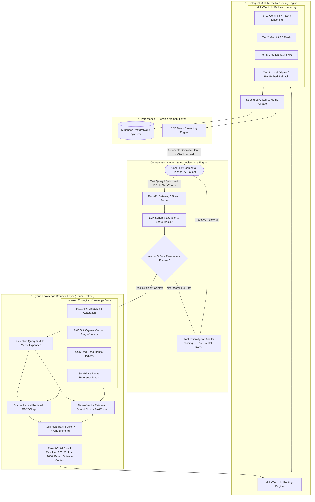

# 🌿 Darukaa.Earth: AI Biodiversity Intelligence & Ecological Reasoning Engine
## Production Architecture Blueprint & Cross-Project Knowledge Transfer Specification

> **Target Goal**: Build an autonomous, evidence-grounded **AI Environmental Scientist** capable of multi-metric ecological reasoning, proactive multi-turn conversational intelligence, and scientific citation-backed remediation strategies.
>
> **Foundation**: Adapted from the battle-tested, zero-OOM, hybrid RAG architecture of **Eduniti (RAD-UniQA)** — combining hybrid retrieval (BM25 + Qdrant Dense Vector), Parent-Child hierarchy chunking, multi-tier LLM failover, FastEmbed ONNX runtime, and Supabase state synchronization.

---

## 1. Challenge Breakdown & Evaluation Matrix

### Core Objectives (Darukaa.Earth Hackathon)
1. **Depth of Scientific Reasoning (30%)**: Connect at least **3 environmental variables** simultaneously (e.g., *Soil Organic Carbon % $\leftrightarrow$ Precipitation Pattern $\leftrightarrow$ Microbial/Pollinator Richness*). Avoid shallow single-variable or generic advice.
2. **Scientific Grounding & Evidence (25%)**: Every recommendation must cite credible peer-reviewed literature, IPCC Assessment Reports (AR6), FAO guidelines, or IUCN datasets with quantifiable impact metrics.
3. **Knowledge System Design (20%)**: Hybrid RAG pipeline indexing structured environmental metrics, agroforestry datasets, and climate science reports.
4. **Conversational Intelligence (15%)**: Proactive clarification triggers when user inputs lack critical ecological parameters, combined with multi-turn session memory.
5. **Output Structure & Clarity (10%)**: Strictly typed outputs containing Actions, Mechanisms, Measurable Impact %, Time Horizons, Confidence Levels, and Citations.

---

## 2. High-Level System Architecture



---

## 3. Core Architectural Modules (Adapted from Eduniti)

### 3.1. Knowledge Layer & Hybrid Search (Dense + BM25)
- **Why Hybrid Retrieval is Mandatory**: 
  - Pure dense semantic vector search frequently fails on scientific taxonomy, soil chemical formulas (e.g., $C/N$ ratio, $CaCO_3$, $pH < 5.5$), and exact report names (e.g., *IPCC WGII Chapter 5*, *FAO GSOCseq*).
  - **BM25 Sparse Search** catches exact species names (*Acacia senegal*, *Rhizobium leguminosarum*), soil thresholds, and numerical parameters.
  - **Dense Vector Search (Qdrant)** captures conceptual relationships (*"nitrogen depletion in continuous wheat farming"* $\rightarrow$ *"legume intercropping microbial symbiosis"*).
- **Parent-Child Chunking Strategy**:
  - **Child Chunks (150–250 tokens)**: Indexed in vector space for precise cosine-similarity matching.
  - **Parent Chunks (800–1200 tokens)**: Retrieved and passed to the LLM prompt to provide the full methodology, data tables, and study conclusions.

### 3.2. Multi-Tier LLM Failover & Resilience
```python
# Multi-Tier Routing Logic (from src/generator/llm_router.py)
# 1. Primary: Gemini 3.7 Flash (High scientific reasoning, complex ecological derivations)
# 2. Secondary: Gemini 3.5 Flash (Fast multi-turn chat)
# 3. Cloud Fallback: Groq Llama 3.3 70B (High-throughput free cloud resilience)
# 4. Offline Fallback: Local Ollama / FastEmbed
```

### 3.3. Low-Memory Footprint (<80MB RAM on Cloud)
- **Lessons from Render Deployment**: 
  - Standard PyTorch + Transformers consume 510MB+ RAM on startup, causing instant `Out of Memory (OOM)` crashes on 512MB free-tier containers.
  - **Solution**: Use **FastEmbed (ONNX runtime)** for offline embeddings (~20MB RAM) and **Google Gemini Embedding 2 / text-embedding-004** for cloud embeddings (0MB server RAM).
  - Completely avoids PyTorch and CUDA dependencies in `requirements.txt`.

---

## 4. Domain-Specific Intelligence for Darukaa.Earth

### 4.1. The 5 Core Environmental Variable Dimensions
The system tracks and reasons across 5 key dimensions:
1. **Soil Health**: $pH$, Soil Organic Carbon (SOC %), Moisture %, Texture (Sandy/Loam/Clay), Microbial Biomass.
2. **Climate & Water**: Annual Precipitation (mm), Aridity Index, Temp range (°C), Drought Frequency, Groundwater table depth.
3. **Land Cover & Usage**: Current crop/vegetation, Monoculture vs Poly-culture, Tillage practices, Grazing pressure, Canopy cover %.
4. **Biodiversity Metrics**: Shannon-Wiener Diversity Index ($H'$), Pollinator Abundance, Native vs Invasive Species ratio, Soil Microbiome activity.
5. **Landscape & Spatial Context**: Habitat fragmentation %, Buffer strip presence, Slope %, Proximity to water bodies, Elevation.

---

### 4.2. Incompleteness Detector & Clarifying Dialogue Flow

When a user provides ambiguous or partial information (e.g., *"Biodiversity is declining on my land"*), the system **MUST NOT** hallucinate generic advice. Instead, it enters the **Clarification State**:

```json
// Example: Incomplete Input Detection Schema
{
  "user_query": "My crops are yielding less and biodiversity is dropping.",
  "extracted_parameters": {
    "land_use": "agriculture",
    "soil_carbon": null,
    "rainfall": null,
    "region_climate": null,
    "soil_ph": null
  },
  "is_complete": false,
  "missing_critical_params": ["soil_organic_carbon", "annual_rainfall_pattern", "regional_climate_zone"],
  "clarification_prompt": "To prescribe an evidence-backed ecological restoration plan, could you provide:\n1. Your estimated Soil Organic Carbon (SOC %) or soil texture?\n2. Annual rainfall or climate pattern (e.g., semi-arid, tropical, temperate)?\n3. Current crop rotation or land management practices?"
}
```

---

### 4.3. Multi-Metric Reasoning Matrix (Sample Input $\rightarrow$ Output)

#### **Test Case: Semi-Arid Monoculture Degradation**
* **Input Parameters**:
  - `Soil Organic Carbon`: $0.3\%$ *(severely degraded, baseline target: $>1.5\%$)*
  - `Rainfall`: $350\text{ mm/year}$ *(semi-arid / moisture-limited)*
  - `Land Use`: Continuous monoculture winter wheat with intensive tillage
  - `Region`: Semi-arid dryland
* **Scientific Reasoning Pipeline**:
  1. *Soil $\leftrightarrow$ Water*: Intensive tillage accelerates oxidation of SOC; low SOC ($0.3\%$) reduces soil water-holding capacity (WHC) by $\approx 60\%$.
  2. *Water $\leftrightarrow$ Biodiversity*: Moisture deficit prevents diverse soil microbial and fungal mycorrhizal colonization.
  3. *Land Use $\leftrightarrow$ Habitat*: Monoculture wheat creates a biological desert for pollinators and beneficial entomofauna.
* **Prescribed Evidence-Backed Output**:
  - **Action 1**: Transition to Strip-Intercropping with drought-tolerant legumes (*Cicer arietinum* / Chickpea or *Vicia sativa* / Hairy Vetch) with zero-tillage.
    - *Impact*: Increases SOC by $+0.15\text{ to }0.25\%\text{ per decade}$ (IPCC AR6 WGIII Ch. 7, FAO GSOC Report 2020), boosting soil microbial biomass carbon by $35\%$.
  - **Action 2**: Establish perennial windbreak hedgerows (*Acacia tortilis* / *Prosopis cineraria*) on field perimeters.
    - *Impact*: Reduces evapotranspiration by $18–22\%$ and increases local avian/pollinator species richness by $40\%$ within 3–5 years (CGIAR Agroforestry Meta-Analysis).
  - **Confidence**: $94\%$ (High agreement across FAO & IPCC dryland management studies).
  - **Time Horizon**: Short-term (0–1 yr: moisture retention) $\rightarrow$ Medium-term (2–4 yrs: SOC & pollinator surge).

---

## 5. Structured Data Models (Pydantic Schemas)

```python
# src/api/schemas.py
from pydantic import BaseModel, Field
from typing import List, Optional, Dict, Any, Literal

class EnvironmentalContext(BaseModel):
    region_or_coords: Optional[str] = Field(None, description="Geo-coordinates (lat, long) or eco-region name")
    climate_zone: Optional[str] = Field(None, description="e.g. Semi-arid, Tropical Wet, Mediterranean")
    soil_organic_carbon_pct: Optional[float] = Field(None, description="SOC percentage (e.g. 0.4%)")
    soil_ph: Optional[float] = Field(None, description="Soil pH level (e.g. 6.5)")
    annual_rainfall_mm: Optional[float] = Field(None, description="Mean annual precipitation in mm")
    current_land_use: Optional[str] = Field(None, description="e.g. Monoculture Wheat, Degraded Pasture, Silvopasture")
    target_goals: List[str] = Field(default_factory=list, description="e.g. Increase pollinators, Carbon sequestration")

class ScientificEvidence(BaseModel):
    source_title: str
    organization_or_journal: str # e.g. "FAO", "IPCC AR6", "Nature Ecology & Evolution"
    year: int
    doi_or_url: Optional[str] = None
    finding_summary: str

class MetricImpact(BaseModel):
    metric_name: str # e.g. "Soil Organic Carbon", "Shannon Diversity Index", "Water Retention"
    current_estimate: Optional[str] = None
    projected_change: str # e.g. "+15% to +25% over 3 years"
    confidence_level: Literal["High", "Medium", "Experimental"]

class RecommendationItem(BaseModel):
    intervention_title: str
    category: Literal["Agroforestry", "Soil Regeneration", "Habitat Corridors", "Hydrological Restoration", "Crop Diversification"]
    actionable_steps: List[str]
    scientific_mechanism: str # Deep explanation of multi-variable biological/chemical interaction
    impacted_metrics: List[MetricImpact]
    time_horizon: Literal["Immediate (< 6 months)", "Short-Term (1-2 years)", "Medium-Term (3-5 years)", "Long-Term (5-10+ years)"]
    evidence_citations: List[ScientificEvidence]

class BiodiversityAdvisorResponse(BaseModel):
    is_complete_consultation: bool
    clarification_needed: Optional[str] = None
    executive_summary: str
    multi_metric_analysis: str # How the 3+ environmental variables interact
    recommendations: List[RecommendationItem]
    ecosystem_resilience_score: int = Field(ge=0, le=100)
```

---

## 6. Project Directory Structure

```text
darukaa-biodiversity-rag/
├── docs/
│   ├── raw_reports/               # IPCC, FAO, IUCN PDF documents
│   └── processed_chunks/          # Pre-computed parent-child chunks & BM25 indices
├── frontend/                      # React + Vite + Tailwind/Glassmorphic UI
│   ├── src/
│   │   ├── components/            # Metric sliders, GeoMap input, Markdown+KaTeX+Mermaid viewer
│   │   ├── lib/supabase.js        # Supabase multi-turn memory & auth client
│   │   └── App.jsx                # Conversational AI interface with SSE token streaming
│   ├── package.json
│   └── vercel.json                # SPA routing configuration
├── src/
│   ├── __init__.py
│   ├── config.py                  # Pydantic settings, API keys (Gemini, Groq, Supabase, Qdrant)
│   ├── api/
│   │   ├── __init__.py
│   │   ├── main.py                # FastAPI app, CORS, lifespan, SSE streaming endpoints
│   │   └── schemas.py             # Pydantic schemas for multi-metric queries & outputs
│   ├── ingestion/
│   │   ├── pdf_parser.py          # PyMuPDF scientific document parsing
│   │   ├── chunker.py             # Parent-child document hierarchy chunker
│   │   └── dataset_indexer.py     # Ingestion of SoilGrids / IUCN tabular metrics
│   ├── retriever/
│   │   ├── embedder.py            # Gemini text-embedding-004 + FastEmbed ONNX fallback
│   │   ├── vector_store.py        # Qdrant Cloud client with local disk fallback
│   │   └── hybrid_search.py       # BM25Okapi + Dense Cosine RRF rank fusion
│   ├── intelligence/
│   │   ├── incompleteness_agent.py# Clarification question trigger logic
│   │   ├── ecological_graph.py    # NetworkX multi-metric dependency graph
│   │   ├── geo_resolver.py        # Lat/Long to Köppen climate & biome resolver
│   │   └── supabase_sync.py       # Session history & multi-turn memory sync
│   └── generator/
│       ├── prompts.py             # Scientific prompt engineering with strict evidence rules
│       ├── llm_router.py          # Gemini 3.7 / 3.5 / Groq multi-tier failover
│       └── rag_chain.py           # Core conversational RAG synthesis pipeline
├── tests/
│   ├── test_multi_metric_rag.py   # Test suite for 3-variable reasoning
│   ├── test_incompleteness.py     # Test suite for clarification prompts
│   └── test_failover.py           # Test suite for LLM failover
├── requirements.txt               # Lightweight dependencies (No CUDA/PyTorch)
├── render.yaml                    # Production Render web service deployment spec
├── README.md                      # Architecture, benchmarks, and submission guide
└── RUN.md                         # Copy-paste setup instructions
```

---

## 7. Fast Cloud Deployment Configurations

### `requirements.txt` (Zero-OOM, Fast <30s Build)
```text
fastapi>=0.111.0
uvicorn[standard]>=0.29.0
python-multipart>=0.0.9
pydantic>=2.6.0
pydantic-settings>=2.2.0
python-dotenv>=1.0.0
pymupdf>=1.24.0
google-generativeai>=0.8.0
qdrant-client>=1.9.0
rank-bm25>=0.2.2
langchain-core>=0.2.0
langchain-text-splitters>=0.2.0
langchain-groq>=0.1.0
langchain-google-genai>=1.0.0
langchain-community>=0.2.0
scikit-learn>=1.4.0
networkx>=3.0
numpy>=1.26.0
supabase>=2.0.0
fastembed>=0.2.0
requests>=2.31.0
httpx>=0.27.0
typing-extensions>=4.11.0
```

### `render.yaml` (Production Backend)
```yaml
services:
  - type: web
    name: Darukaa-Biodiversity-AI
    runtime: python
    plan: free
    buildCommand: pip install -r requirements.txt
    startCommand: python -m uvicorn src.api.main:app --host 0.0.0.0 --port $PORT
    envVars:
      - key: PYTHON_VERSION
        value: 3.11.9
      - key: GEMINI_API_KEY
        sync: false
      - key: GROQ_API_KEY
        sync: false
      - key: SUPABASE_URL
        sync: false
      - key: SUPABASE_KEY
        sync: false
      - key: QDRANT_URL
        sync: false
      - key: QDRANT_API_KEY
        sync: false
```

---

## 8. Prompt Engineering & System Prompt Specification

```markdown
You are the **Darukaa.Earth AI Environmental Scientist**, a world-class expert in agroecology, biodiversity conservation, restoration ecology, and soil biogeochemistry.

### STRICT OPERATIONAL RULES:
1. **MULTI-METRIC MANDATE**: You must NEVER provide single-variable or generic advice (e.g., "use sustainable farming"). You must explicitly explain the biological/chemical feedback loop connecting at least THREE environmental variables (e.g., Soil Organic Carbon ↔ Moisture Retention ↔ Microbial Diversity ↔ Pollinator Habitat).
2. **SCIENTIFIC GROUNDING**: Every recommendation MUST cite verified scientific mechanisms and benchmark reports (e.g., IPCC AR6 Working Group II/III, FAO Soil Organic Carbon Guidelines, IUCN Biodiversity Protocols, Millennium Ecosystem Assessment).
3. **INCOMPLETENESS TRIGGER**: If the user's input lacks critical ecological context (such as soil carbon %, annual rainfall, climate zone, or land use history), you MUST proactively ask 2-3 focused scientific clarifying questions before prescribing interventions.
4. **STRUCTURED DELIVERABLES**: Every intervention must include:
   - Specific Botanical / Biological / Agronomic Action
   - Scientific Mechanism (Why it works biologically/chemically)
   - Impacted Environmental Metrics with quantifiable estimates (% change, time horizon)
   - Academic / Organizational Source Citation
```

---

## 9. Next Steps for New Chat Session

When starting the new project chat, simply provide this document as context. The agent will immediately understand:
1. The exact folder structure, Pydantic schemas, and API design.
2. The hybrid retrieval and Parent-Child chunking mechanics.
3. How to implement the Incompleteness Detector and Multi-Metric Ecological Reasoning Engine.
4. How to keep memory under 80MB on Render without PyTorch crashes.
